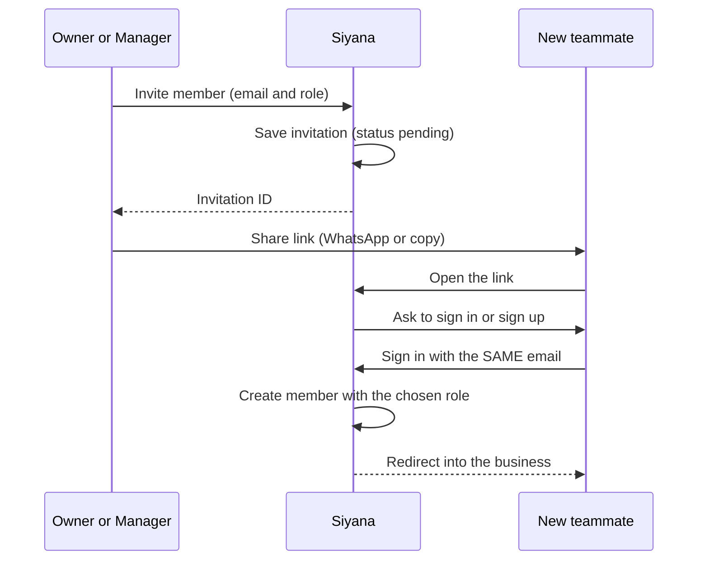
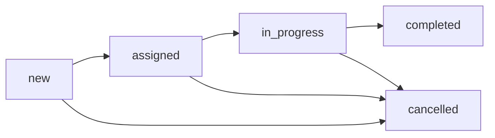

# Siyana: Roles, Permissions and Application Flow

This guide explains who can do what in the app, how people hand work to each other, and which rules are enforced today versus still to be built.

Sections marked **Enforced today** come from your real `permissions.ts` and `auth.ts`. Sections marked **Target design** are my proposal, based on your brief and the sidebar. Nothing in them is enforced yet, because I haven't seen any job, customer, or finance code.

---

## 1. The big picture

Siyana is **multi-tenant**: many plumbing and HVAC businesses share one app and one database, and each business only ever sees its own data.

There are **two separate layers of roles**. Mixing them up is the most common confusion.

| Layer              | Lives on                       | Values                                       | Answers the question                                |
| ------------------ | ------------------------------ | -------------------------------------------- | --------------------------------------------------- |
| **Platform role**  | the user account               | `admin`, `user`                              | "What can this person do to the whole platform?"    |
| **Workspace role** | the membership in one business | `owner`, `manager`, `technician`, `customer` | "What can this person do inside this one business?" |

The same person can be `owner` in one business and `technician` in another. Their platform role stays `user` throughout.

### Key terms

| Term                    | Meaning                                                                                           |
| ----------------------- | ------------------------------------------------------------------------------------------------- |
| **User**                | A login account (email and password). Global to the platform.                                     |
| **Organization**        | One plumbing or HVAC business. The unit of isolation.                                             |
| **Member**              | A user's membership in an organization, carrying one workspace role.                              |
| **Active organization** | The business you're currently working in, chosen with the switcher and stored on your session.    |
| **Customer (record)**   | A row in the `customers` table: a homeowner or company the business serves. Usually has no login. |
| **Customer (role)**     | A workspace role for a customer who does have a login. See section 6.4.                           |
| **Invitation**          | A pending offer to join an organization with a specific role.                                     |

---

## 2. Platform roles

### `admin`: you, the platform owner

Admins run the platform, not a plumbing business.

**Enforced today:**

- Create users, list users, set a user's role, ban users, impersonate users, delete users. These come from your `admin` role in `permissions.ts`.
- Create organizations even without the `canCreateOrganization` flag.
- Use the `/admin/users` page. The sidebar shows the Platform → Users link only to admins.

**Notes:**

- An admin is **not automatically an owner or manager** of any business. To see what a business sees, **impersonate** one of its users.
- Banning is global. A banned user loses access to every business they belong to.
- Impersonation shows a **Stop impersonating** button in the sidebar footer.

### `user`: everyone else

The default for every signup. It has **no platform powers**.

A new `user` can't create a business unless `canCreateOrganization` is `true` on their account. Today, you set that flag in the database or through an admin action.

---

## 3. Workspace roles

### Owner: the business owner

**In plain words:** the person who bought the subscription. They run the business and have the final say.

**Enforced today (Better Auth):**

- Update and delete the organization
- Create, update, and delete members
- Create and cancel invitations

**Sidebar shows:** Dashboard, Jobs, Schedule, Customers, Finances, Team, Settings.

**Target design:** everything a manager can do, plus owner-only actions such as billing and deleting the business. An owner is the only role that can remove members.

### Manager: office, dispatcher

**In plain words:** runs the day-to-day. Takes calls, creates jobs, assigns technicians, tracks money.

**Enforced today (Better Auth):**

- Update the organization (but not delete it)
- Create and update members
- Create and cancel invitations

**Sidebar shows:** the same as the owner (Dashboard, Jobs, Schedule, Customers, Finances, Team, Settings).

**Target design:** manage customers and jobs, assign technicians, record payments and costs.

**Check this:** a manager has `member: update`, which is what changes someone's role. Test whether a manager can promote another member to `owner`. If they can, remove `update` from the manager's `member` permissions, or only let owners change roles.

### Technician: field worker

**In plain words:** goes to the customer's home, does the work, reports back.

**Enforced today (Better Auth):** nothing. The role has no organization permissions. It can't invite, remove, or edit anything about the organization.

**Sidebar shows:** Dashboard, My Jobs, Schedule, Settings.

**Target design:**

- See only jobs assigned to them.
- Start a job, complete it, and add notes.
- Record costs such as parts on their own jobs.
- See the customer's name, phone, and address for their jobs only.
- Not see finances, other technicians' jobs, or the agreed price.

### Customer: client with a login

**In plain words:** a homeowner or business that has been given a portal account.

**Enforced today (Better Auth):** nothing. The role is empty.

**Sidebar shows:** Dashboard, My Requests, Settings.

**Target design:** see only their own jobs and payments, and submit a service request. Most customers never need an account. See section 6.4.

**Heads up:** `defaultRole: "customer"` in `auth.ts` means an invitation with no explicit role becomes a customer. That's a safe default because the role has no powers.

---

## 4. Permission tables

### 4.1 Enforced today (Better Auth)

| Action                           | Owner | Manager | Technician | Customer |
| -------------------------------- | :---: | :-----: | :--------: | :------: |
| Update organization (name, logo) |  ✅   |   ✅    |     ❌     |    ❌    |
| Delete organization              |  ✅   |   ❌    |     ❌     |    ❌    |
| Add or edit members              |  ✅   |   ✅    |     ❌     |    ❌    |
| Remove members                   |  ✅   |   ❌    |     ❌     |    ❌    |
| Send invitations                 |  ✅   |   ✅    |     ❌     |    ❌    |
| Cancel invitations               |  ✅   |   ✅    |     ❌     |    ❌    |

Platform level:

| Action                        | Admin |                  User                   |
| ----------------------------- | :---: | :-------------------------------------: |
| Create, list, delete users    |  ✅   |                   ❌                    |
| Change a user's platform role |  ✅   |                   ❌                    |
| Ban or unban                  |  ✅   |                   ❌                    |
| Impersonate                   |  ✅   |                   ❌                    |
| Create an organization        |  ✅   | only if `canCreateOrganization` is true |

I recommended giving your admin role the full permission set (`...adminAc.statements`), because the `/admin/users` drawer needs `get`, `update`, `set-password`, and the session permissions. If you haven't applied that, some buttons stay disabled.

### 4.2 Target design for business data (not enforced yet)

| Action                            | Owner |      Manager      |     Technician     |       Customer        |
| --------------------------------- | :---: | :---------------: | :----------------: | :-------------------: |
| View all customers                |  ✅   |        ✅         |         ❌         |          ❌           |
| Create or edit customers          |  ✅   |        ✅         |         ❌         |          ❌           |
| View a customer's contact details |  ✅   |        ✅         | only on their jobs |    only their own     |
| Create jobs                       |  ✅   |        ✅         |         ❌         | request only (future) |
| View jobs                         |  all  |        all        |   assigned only    |       own only        |
| Assign technicians                |  ✅   |        ✅         |         ❌         |          ❌           |
| Change job status                 |  ✅   |        ✅         |   own jobs only    |          ❌           |
| Record costs                      |  ✅   |        ✅         |   own jobs only    |          ❌           |
| Record payments                   |  ✅   |        ✅         |         ❌         |          ❌           |
| See the agreed price              |  ✅   |        ✅         | **your decision**  |     own jobs only     |
| See the Finances page             |  ✅   | **your decision** |         ❌         |          ❌           |
| Invite or manage team             |  ✅   |        ✅         |         ❌         |          ❌           |

The two "your decision" cells are business rules for you to set. For example, should managers see finances, and should technicians see prices? The sidebar currently shows Finances to both owners and managers.

---

## 5. How roles "communicate"

**There's no chat or messaging system.** Roles talk to each other through **shared records**. One person changes a record, and the next person sees it.

| From → To                       | What is handed over                    | Where it lives                                    |
| ------------------------------- | -------------------------------------- | ------------------------------------------------- |
| Customer → Manager              | A call, a message, or a portal request | a new row in `jobs` (status `new`)                |
| Manager → Technician            | "Go do this job"                       | a row in `job_assignments` plus status `assigned` |
| Technician → Manager            | "I started", "I finished", notes       | job status and `job_activity`                     |
| Technician → Manager            | Parts or materials used                | rows in `job_costs`                               |
| Manager → Owner                 | Money received                         | rows in `job_payments`                            |
| Owner or Manager → New teammate | An invitation                          | a row in `invitation`, delivered as a link        |
| Admin → Anyone                  | Account actions, support               | `user` role, ban, impersonation                   |

The **`job_activity` table** is the closest thing to communication. It's a timeline of what happened on each job and who did it, so anyone with access sees the history.

**Notifications:** nothing is built. Technicians don't get an alert when they're assigned a job. Until you add notifications, a manager would need to tell them outside the app, for example with a WhatsApp link to the job.

---

## 6. Flows

### 6.1 Onboarding a new business

1. A plumbing business owner signs up. They get platform role `user` and `canCreateOrganization = false`.
2. They land in the app with no workspace. The sidebar shows **Set up your workspace**.
3. **You (admin)** enable the flag: `update "user" set can_create_organization = true where email = '...'`. This is manual for now, and a toggle in the admin drawer would be a nice later addition.
4. The owner refreshes, opens the switcher, and creates the organization. Because `creatorRole: "owner"`, they become its **owner**.
5. They can create up to 3 organizations (`organizationLimit: 3`).

### 6.2 Inviting a team member

You have no email provider, so the invitation travels as a **link** that the inviter shares manually (for example over WhatsApp).



Key points:

- The person must use **the same email** the invitation was sent to. This is the security check, since the link alone isn't enough.
- Invitations **expire** (48 hours by default). The owner or manager can **resend** one from the People page, which extends the expiry.
- Only owners and managers can invite (`invitation: create`).
- The role dropdown in the invite dialog decides what the new member can do.

### 6.3 A job from start to finish (target design)



| Step                | Who                   | What happens                                                                                                         |
| ------------------- | --------------------- | -------------------------------------------------------------------------------------------------------------------- |
| 1. Request comes in | Customer or Manager   | A job is created with a customer, a title, a priority, an optional schedule time, and an agreed price. Status `new`. |
| 2. Assign           | Manager               | One or more technicians are added through `job_assignments`. Status `assigned`.                                      |
| 3. Do the work      | Technician            | The technician starts the job. Status `in_progress`.                                                                 |
| 4. Track costs      | Technician or Manager | Parts and materials are added to `job_costs`.                                                                        |
| 5. Finish           | Technician            | Status `completed`, `completedAt` is set.                                                                            |
| 6. Get paid         | Manager or Owner      | The payment goes into `job_payments`.                                                                                |
| 7. Review           | Owner                 | Finances show price, costs, and payments per job.                                                                    |

Every step should also write a line to `job_activity`.

Notes:

- A job can have several technicians. Unassigning a technician keeps history, because `unassignedAt` is set instead of deleting the row.
- A technician can't be assigned to the same job twice while active (a database rule prevents duplicates).
- Money is stored as exact decimals (`numeric(12,2)`), never floating-point numbers. The default currency is EGP.

### 6.4 Customer record vs customer login

These are two different things, and mixing them up causes confusion.

|                   | **Customer record**              | **Customer role (login)**           |
| ----------------- | -------------------------------- | ----------------------------------- |
| Table             | `customers`                      | `user` + `member`                   |
| Has a password    | No                               | Yes                                 |
| Who creates it    | Owner or Manager                 | An invitation                       |
| How many          | Every client the business serves | Only clients who need portal access |
| Link between them | `customers.userId` (optional)    |                                     |

**Most customers should only be records.** The owner adds the homeowner's name, phone, and address, then creates jobs for them. Nobody needs to log in.

When a customer wants to follow their jobs online, you invite them with the `customer` role and set `customers.userId` to link their account to their record.

### 6.5 Support: ban and impersonate (admin only)

- **Ban:** `/admin/users` → click the user → ban. They can't sign in, their sessions are revoked, and it applies across all businesses.
- **Impersonate:** the same drawer. You are signed in as that user. Use **Stop impersonating** in the sidebar footer to return.
- Use impersonation to reproduce a problem, and avoid changing data while impersonating.
- An owner can't ban or impersonate anyone. If an owner needs someone gone from their business, they remove that member from the People page.

---

## 7. Where rules are enforced

There are three layers, and **only the top one is real security**.

| Layer                                                           | Example                                          | Real security? |
| --------------------------------------------------------------- | ------------------------------------------------ | -------------- |
| **1. Server (Better Auth endpoints and your server functions)** | Rejects a technician's invite request            | ✅ Yes         |
| **2. UI components**                                            | The invite button is disabled without permission | ❌ Cosmetic    |
| **3. Sidebar and navigation**                                   | Technicians don't see Finances                   | ❌ Cosmetic    |

Hiding a link is not protection, because a technician can still type `/finances` into the address bar. Every job, customer, and finance server function needs its own check.

A minimal pattern for every server function:

```ts
// 1. Who is calling, and which business are they in?
const session = await auth.api.getSession({ headers: getRequestHeaders() });
if (!session) throw new Error("Unauthorized");

const member = await auth.api.getActiveMember({ headers: getRequestHeaders() });
if (!member) throw new Error("No active organization");

// 2. Is their role allowed to do this?
const roles = member.role.split(",");
if (!roles.some((r) => ["owner", "manager"].includes(r))) {
  throw new Error("Forbidden");
}

// 3. Scope every query to their business
const rows = await db
  .select()
  .from(jobs)
  .where(eq(jobs.organizationId, member.organizationId));
```

The tenant rule matters most: **every query on operational data filters by `organizationId`**, using the value from the member record, never one the browser sends.

---

## 8. Gaps and what to build next

| Gap                                                    | Why it matters                                          | Suggested fix                                                    |
| ------------------------------------------------------ | ------------------------------------------------------- | ---------------------------------------------------------------- |
| Business permissions aren't enforced                   | Any member might call job or finance functions directly | A shared `requireRole()` helper used by every server function    |
| `ac` has no `job`, `customer`, or `payment` statements | Better Auth can't check these actions for you           | Add statements and roles, or keep role checks in your own helper |
| Technicians and customers have empty roles             | They rely entirely on your own checks                   | Decide the exact rules from the target table in 4.2              |
| Manager can possibly promote to owner                  | A privilege escalation risk                             | Test it, and remove `member: update` from managers if it works   |
| No notifications                                       | Technicians don't learn about new jobs                  | Start with a WhatsApp link, then email once you have a provider  |
| `canCreateOrganization` is set by SQL                  | Slows onboarding                                        | Add a toggle in the admin users drawer                           |
| No audit of who did what                               | Hard to resolve disputes                                | Write to `job_activity` on every job change                      |

If you later want owners to define their own roles, such as a "Dispatcher", Better Auth's **dynamic access control** supports that, but it's best to settle the fixed roles first.

---

## 9. One-page cheat sheet

- **Admin** runs the platform: users, bans, impersonation.
- **Owner** runs the business: everything, including removing members and deleting the business.
- **Manager** runs operations: invites people, creates and assigns jobs, records payments.
- **Technician** does the work: sees assigned jobs, updates their status, adds costs.
- **Customer** (with a login) follows their own jobs. Most customers are only records and never log in.
- Roles communicate through **shared data** (jobs, assignments, activity), not messages.
- Every business is isolated by **`organizationId`**, and every query must filter by it.
- Hiding a menu item doesn't protect anything. The **server check** is what counts.
